# 🔒 DeVault


> 개발자를 위한 macOS 시크릿 관리 애플리케이션

[](https://apps.apple.com/kr/app/devault-secure-dev-secrets/id6802093482?mt=12)

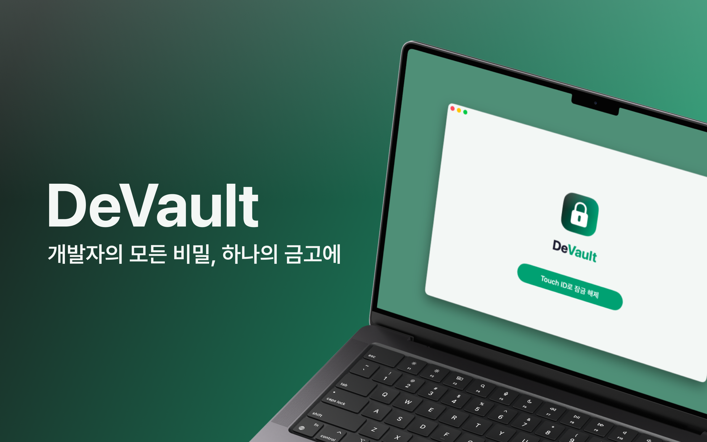

## 🚀 프로젝트 소개

- **개발 기간:** 2026.03 ~ 현재
- **프로젝트 목표:** DeVault(Dev + Vault)는 macOS에서 개발자가 사용하는 API 키, 토큰, 환경 변수 등의 시크릿을 관리하는 네이티브 애플리케이션입니다. 로컬 우선 아키텍처를 바탕으로 시크릿을 기기에 암호화해 저장하고, 개발 워크플로우에 자연스럽게 녹아드는 사용 경험을 제공합니다.

---

## ✨ 주요 기능

### 다양한 시크릿 지원

API 키와 액세스 토큰, 웹훅 시크릿, OAuth 정보, 데이터베이스 접속 정보, SSH 키, SSL/TLS 인증서, 환경 변수 세트, 라이선스 키 등을 유형별 입력 폼으로 관리합니다.

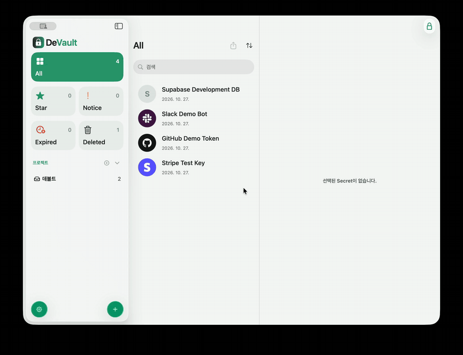

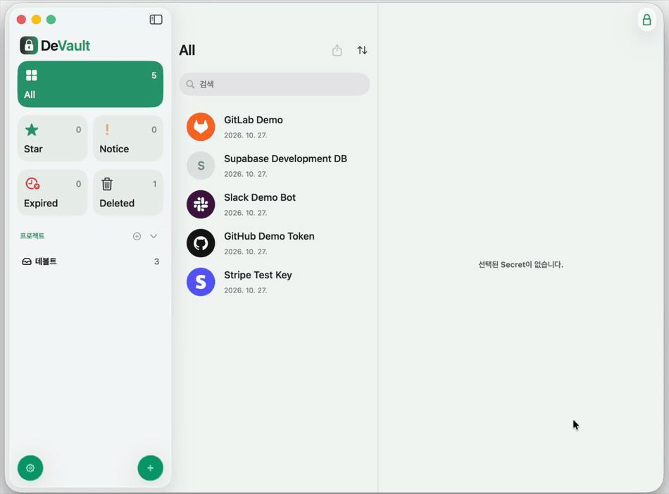

### 프로젝트·환경별 시크릿 관리

시크릿을 프로젝트에 연결하고 개발·스테이징·프로덕션 환경을 지정해 관리합니다. 즐겨찾기와 검색·필터·정렬 기능으로 필요한 시크릿을 빠르게 찾을 수 있습니다.

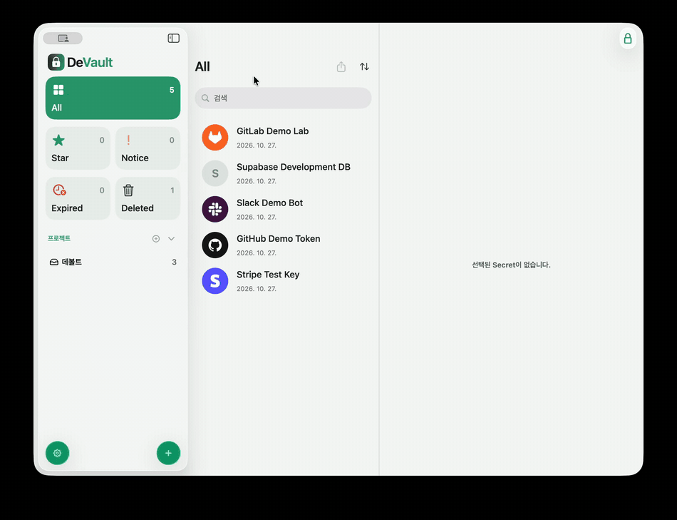

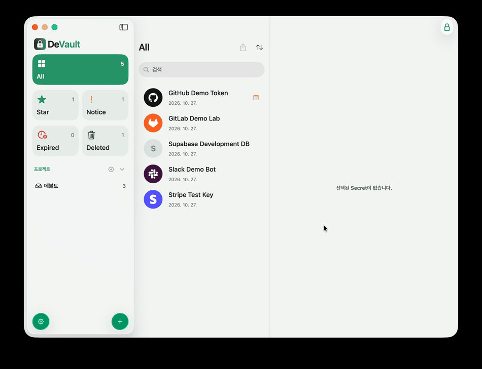

### 보안 정책

시크릿 열람과 복사, 수정 등 민감한 작업에 Touch ID 또는 Mac 사용자 인증을 사용하고, 일정 시간 사용하지 않으면 앱을 자동으로 잠급니다. 복사한 값은 설정한 시간이 지나면 클립보드에서 삭제하며, 화면 캡처 보호와 반복 인증 실패·복사 감지 알림을 제공합니다.

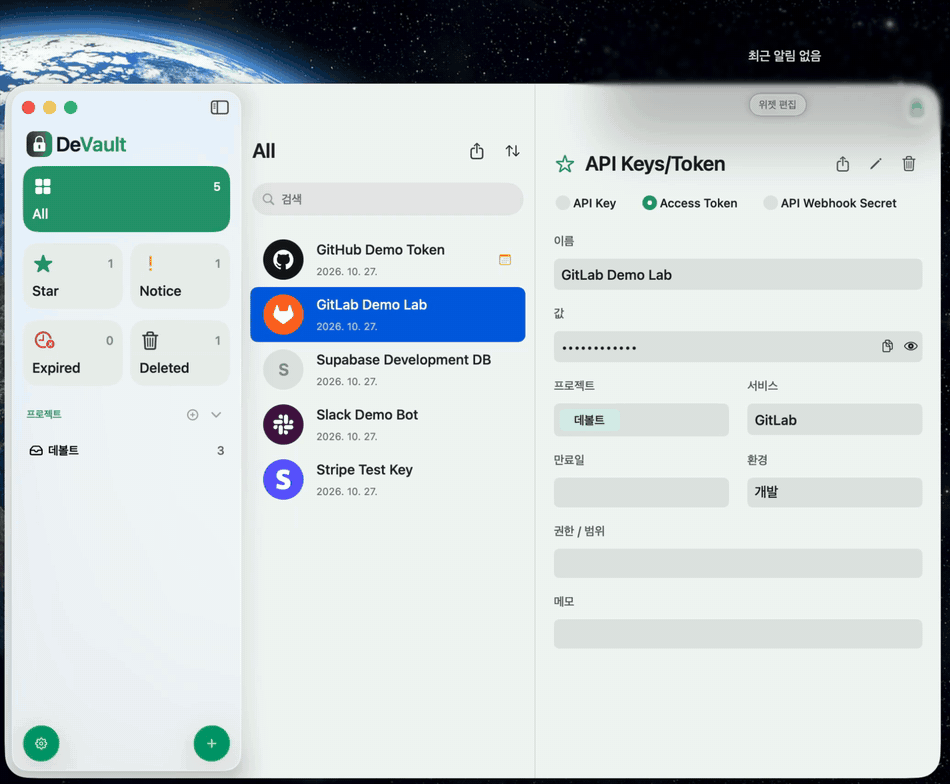

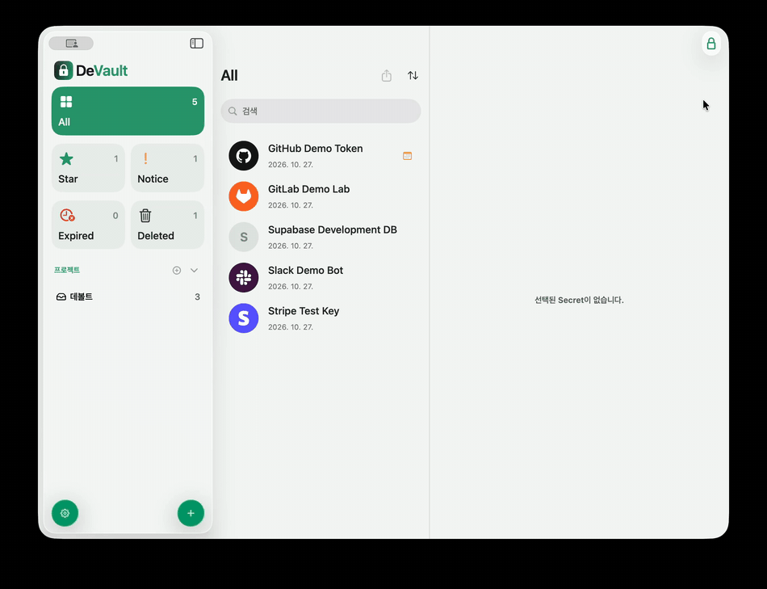

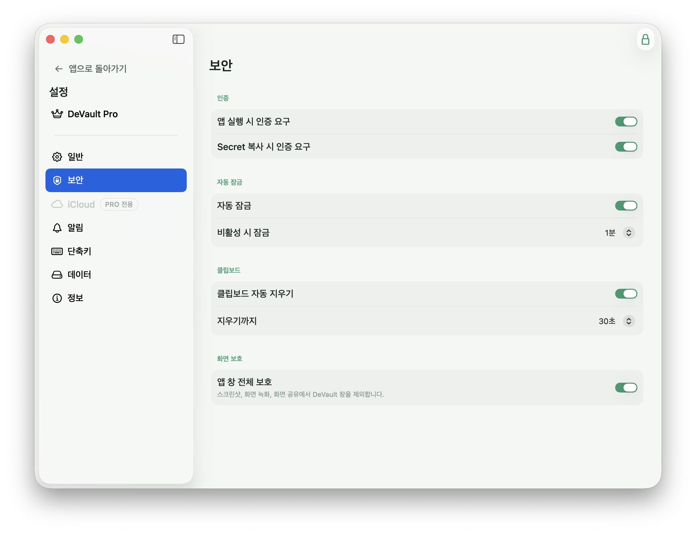

### 만료 관리와 알림

시크릿별 만료일을 설정하고 만료 30일·7일·3일 전 또는 만료 당일에 알림을 받도록 설정할 수 있습니다.

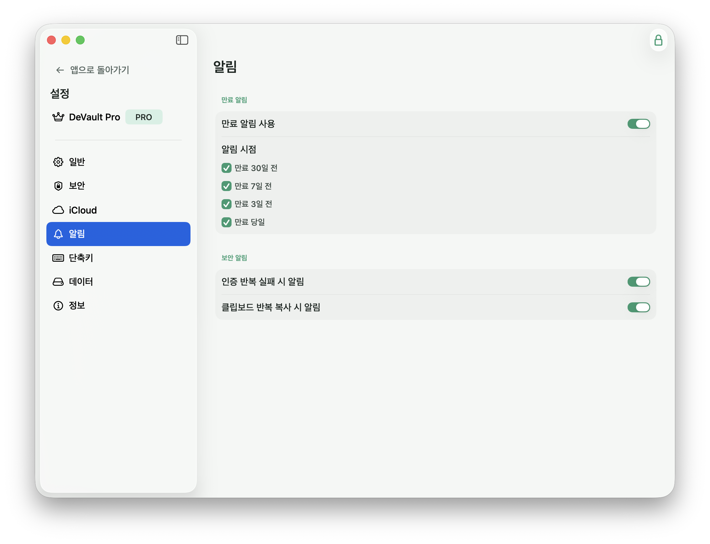

### iCloud 동기화

암호화된 시크릿 데이터를 iCloud를 통해 동기화해 사용하는 Mac에서 이어서 관리할 수 있습니다.

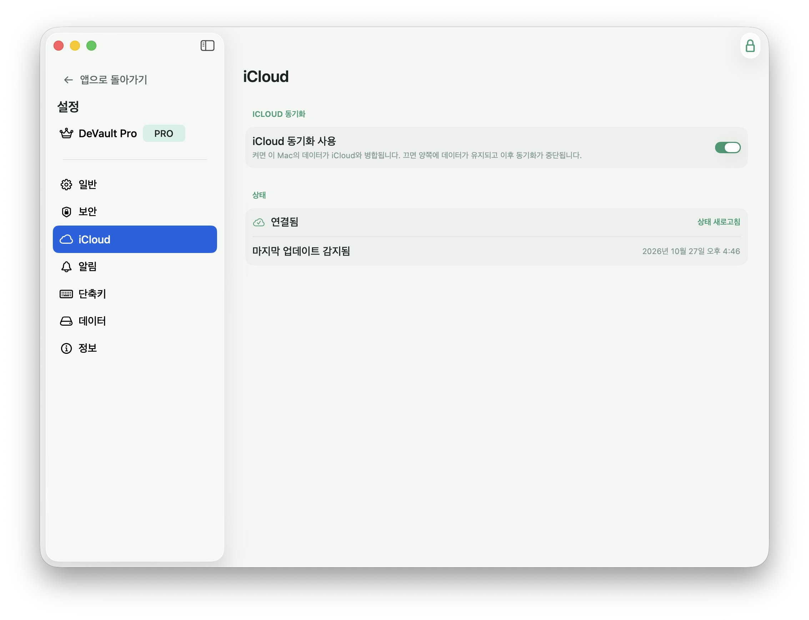

### 테마와 DeVault Pro

시스템 설정에 맞추거나 라이트·다크 모드를 선택할 수 있습니다. DeVault Pro 구독으로 시크릿과 프로젝트를 제한 없이 관리하고, 여러 만료 알림 시점을 사용할 수 있습니다.

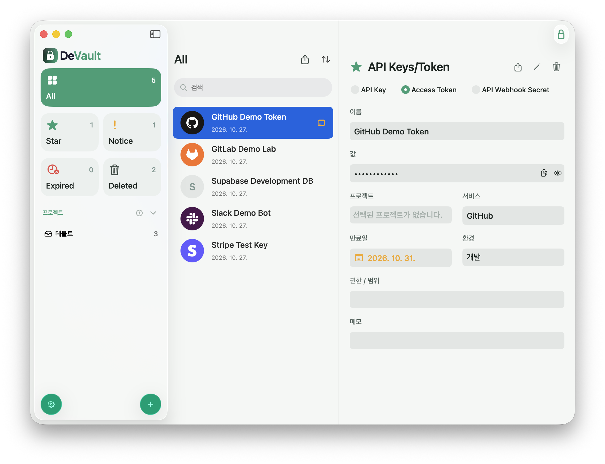

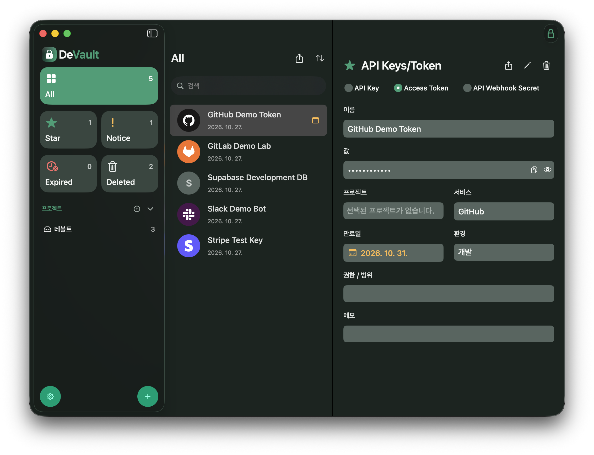

무료 버전은 시크릿 15개, 프로젝트 1개까지 사용할 수 있으며 보안 기능을 포함합니다.

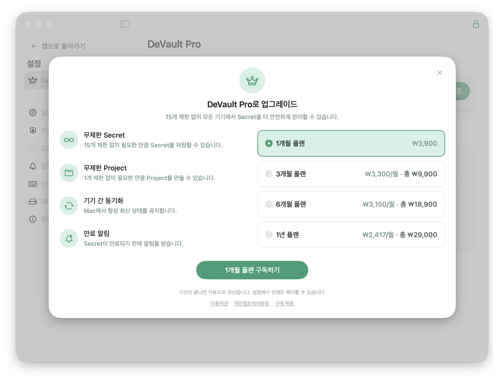

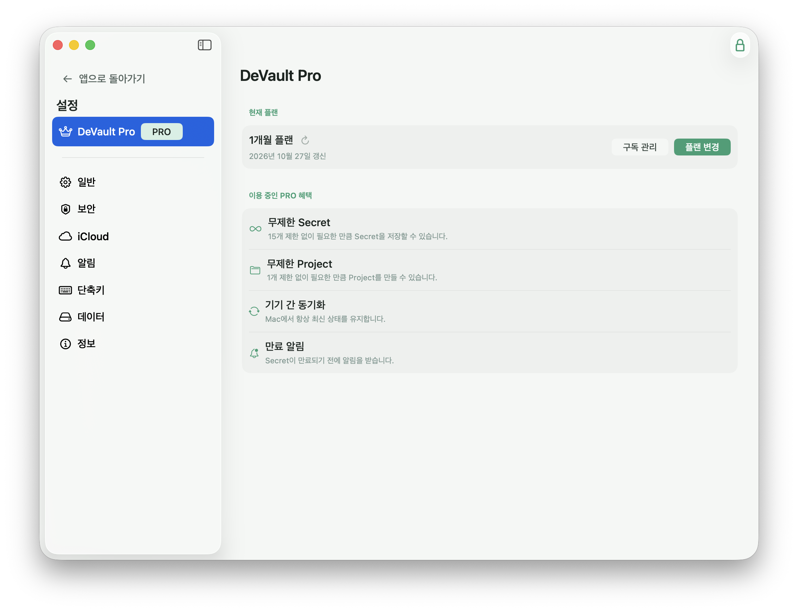

---

## 🛠 기술 스택

- **언어·UI:** Swift, SwiftUI
- **상태 관리:** The Composable Architecture (TCA)
- **프로젝트 구성:** Tuist
- **외부 패키지 관리:** Swift Package Manager (Tuist 연동)
- **저장·동기화:** SwiftData, CloudKit
- **보안:** CryptoKit (AES-GCM), Keychain, LocalAuthentication
- **결제:** StoreKit 2

## 🧩 모듈 구조

Tuist로 모듈마다 독립된 Xcode 프로젝트를 구성했습니다. 화면과 비즈니스 규칙, 데이터 구현을 분리하고, 앱 모듈에서 실제 구현체를 조립합니다.

| 모듈 | 역할 |
|---|---|
| `Devault` | macOS 앱 진입점 및 조립 지점. 데이터·도메인 구현체와 프레젠테이션 기능을 연결합니다. |
| `DVPresentation` | SwiftUI 화면, TCA 기반 기능 상태와 액션, 사용자 인터페이스 로직을 담당합니다. |
| `DVDomain` | 도메인 모델, 유스케이스, 저장소·서비스 인터페이스, 시크릿 탐지 규칙을 정의합니다. |
| `DVData` | 도메인 인터페이스를 구현하고 SwiftData 저장, 암호화·인증, iCloud 동기화 등 데이터 작업을 담당합니다. |
| `DVDesign` | 여러 화면에서 재사용하는 디자인 시스템과 UI 컴포넌트를 제공합니다. |
| `DVCore` | 로깅 등 공통 기반 기능을 제공합니다. |
| `DVNetwork`, `DVStorage` | 향후 확장을 위해 준비한 모듈이며 현재 앱 기능에서는 사용하지 않습니다. |

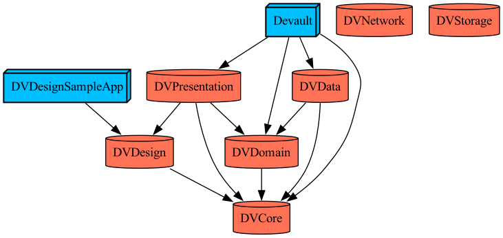

## 🗂 폴더 구조

```text
Projects/
├── Devault/
│   ├── Sources/
│   │   └── Composition/
│   │       ├── AppShell/
│   │       ├── Dependencies/
│   │       └── Graph/
│   └── Resources/
├── DVPresentation/
│   ├── Sources/
│   │   ├── Features/
│   │   │   ├── CreateProject/
│   │   │   ├── CreateSecret/
│   │   │   ├── Lock/
│   │   │   ├── Main/
│   │   │   ├── Onboarding/
│   │   │   ├── SecretDetail/
│   │   │   ├── SecretList/
│   │   │   ├── SelectSecretType/
│   │   │   ├── Settings/
│   │   │   └── Sidebar/
│   │   ├── Dependencies/
│   │   ├── Form/
│   │   ├── Localization/
│   │   └── AppMenu/
│   └── Resources/
├── DVDomain/
│   └── Sources/
│       ├── Detection/
│       │   ├── Detector/
│       │   ├── Model/
│       │   ├── Rule/
│       │   ├── Security/
│       │   └── Support/
│       ├── Entity/
│       ├── Repository/
│       │   ├── Error/
│       │   ├── Interface/
│       │   └── Model/
│       ├── SecretContent/
│       │   ├── Metadata/
│       │   └── Payload/
│       ├── Service/
│       │   ├── Error/
│       │   └── Interface/
│       └── UseCase/
│           ├── Draft/
│           ├── Error/
│           ├── Impl/
│           └── Interface/
├── DVData/
│   └── Sources/
│       ├── RepositoryImpl/
│       │   ├── DataReset/
│       │   ├── Project/
│       │   ├── Secret/
│       │   └── Settings/
│       ├── ServiceImpl/
│       │   ├── App/
│       │   ├── Authentication/
│       │   ├── Clipboard/
│       │   ├── ICloudSync/
│       │   ├── Notification/
│       │   ├── Purchase/
│       │   ├── Security/
│       │   └── Settings/
│       └── Storage/
│           └── Local/
│               └── Models/
├── DVDesign/
│   ├── Sources/
│   │   ├── Components/
│   │   ├── Extensions/
│   │   └── Foundations/
│   │       ├── Color/
│   │       ├── Expiry/
│   │       ├── Fonts/
│   │       ├── Image/
│   │       ├── Motion/
│   │       ├── ServiceLogo/
│   │       ├── Sizing/
│   │       └── Tooltip/
│   ├── Resources/
│   └── SampleApp/
├── DVCore/
│   └── Sources/
│       ├── Formatting/
│       └── Logger/
├── DVNetwork/  # 향후 확장용
└── DVStorage/  # 향후 확장용
```

## 👥 팀원 소개

| [김도연](https://github.com/doyeonk429) | [이예성](https://github.com/yeseonglee) | [이현주](https://github.com/dlguszoo) |
|:---:|:---:|:---:|

---

## 자주 쓰는 명령어

| 명령어 | 설명 |
|---|---|
| `tuist generate` | Xcode 워크스페이스 재생성 |
| `generate-local` | iCloud entitlement 없이 재생성 (팀 시트 없는 경우) |
| `tuist install` | 외부 패키지 fetch (Package.swift 변경 시) |
| `tuist clean` | Tuist 캐시 및 생성 파일 삭제 |
| `./scripts/bootstrap_modules.sh` | 새 모듈 디렉토리 초기화 |

---

## 외부 의존성

| 패키지 | 용도 |
|---|---|
| [swift-composable-architecture](https://github.com/pointfreeco/swift-composable-architecture) | TCA - DVPresentation 상태 관리 |

---

## 새 모듈 추가하기

> 예시: `DVFeatureVault` 모듈을 새로 추가하는 경우

### 1. `DVModule.swift`에 케이스 추가

```swift
// Tuist/ProjectDescriptionHelpers/DVModule.swift
public enum DVModule: String, CaseIterable {
    ...
    case DVFeatureVault  // 추가
}
```

`name`, `bundleId`, `path`, `dependency`는 자동으로 생성됩니다.

### 2. `TargetDependency+Module.swift`에 헬퍼 추가

```swift
// Tuist/ProjectDescriptionHelpers/TargetDependency+Module.swift
extension TargetDependency {
    public static func featureVault() -> TargetDependency {
        DVModule.DVFeatureVault.dependency
    }
}
```

### 3. 모듈 디렉토리 생성

```bash
./scripts/bootstrap_modules.sh
```

`DVFeatureVault/` 디렉토리와 기본 `Project.swift`가 자동 생성됩니다.

### 4. `Project.swift` 수정 (필요 시)

bootstrap으로 생성된 기본 `Project.swift`를 필요에 맞게 수정합니다.

```swift
// Projects/DVFeatureVault/Project.swift
import ProjectDescription
import ProjectDescriptionHelpers

let project = Project.project(
    name: DVModule.DVFeatureVault.name,
    targets: [
        .target(
            name: DVModule.DVFeatureVault.name,
            product: Project.product,
            sources: .sources,
            dependencies: [
                .domain(),
                .design(),
            ]
        ),
        .tests(
            name: DVModule.DVFeatureVault.name,
            dependencies: [DVModule.DVFeatureVault.dependency]
        ),
    ]
)
```

### 5. 워크스페이스 재생성

```bash
tuist generate
```

`Workspace.swift`는 `DVModule.allCases`를 자동으로 순회하므로 별도 수정이 필요 없습니다.

---

## 외부 라이브러리 추가하기

> 예시: `Alamofire`를 추가하는 경우

### 1. `Tuist/Package.swift`에 패키지 추가

```swift
// Tuist/Package.swift
let packageSettings = PackageSettings(
    productTypes: [
        "ComposableArchitecture": .staticFramework,
        "Alamofire": .staticFramework,  // 추가
    ]
)

let package = Package(
    name: "Devault",
    dependencies: [
        .package(
            url: "https://github.com/pointfreeco/swift-composable-architecture",
            from: "1.15.0"
        ),
        .package(
            url: "https://github.com/Alamofire/Alamofire",  // 추가
            from: "5.0.0"
        ),
    ]
)
```

> `productTypes`에 추가하면 정적 프레임워크로 링크됩니다. 동적 프레임워크가 필요한 경우 생략하세요.

### 2. `TargetDependency+External.swift`에 케이스 추가

```swift
// Tuist/ProjectDescriptionHelpers/TargetDependency+External.swift
public enum External: String {
    case ComposableArchitecture
    case Alamofire  // 추가
}
```

### 3. 패키지 fetch

```bash
tuist install
```

### 4. 사용할 모듈의 `Project.swift`에 의존성 추가

```swift
.target(
    name: DVModule.DVNetwork.name,
    product: Project.product,
    sources: .sources,
    dependencies: [
        .external(dependency: .Alamofire),
    ]
)
```

### 5. 워크스페이스 재생성

```bash
tuist generate
```

---

## 테스트

Swift Testing을 사용합니다.

```swift
import Testing
@testable import DVDomain

@Suite("UseCase 이름")
struct SomeUseCaseTest {
    @Test("성공 시 올바른 값을 반환한다")
    func success() {
        #expect(result == expected)
    }
}
```

테스트 타겟은 `Project.swift`에서 `.tests()` 템플릿으로 추가합니다.

```swift
.tests(
    name: DVModule.DVDomain.name,
    dependencies: [DVModule.DVDomain.dependency]
)
```

---

## 📄 라이선스

이 프로젝트는 [MIT License](LICENSE)를 따릅니다.
